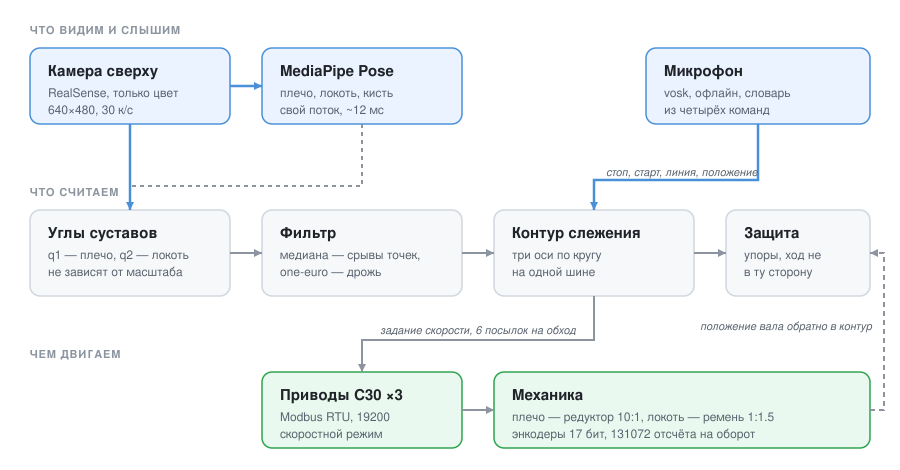

https://github.com/user-attachments/assets/e25a251a-694e-42c8-9c42-39ede91aa529


https://github.com/user-attachments/assets/ba809d6b-ba62-4079-94ff-202059283509


<div align="center">

# SCARA, который повторяет движения руки

**Камера сверху смотрит на человека. Манипулятор повторяет за ним — плечом и локтем, в реальном времени.**
Без контроллера движения: обычный ноутбук, три сервопривода на одной шине RS-485 и немного геометрии.

<!-- КАРТИНКА: положите docs/media/обложка.jpg и раскройте строку ниже

-->

</div>

---

## Что это

Промышленный сервопривод C30 не умеет ездить по координатам: позиционное задание он
принимает только импульсами по отдельным входам, а по Modbus доступны лишь скорость,
пуск и параметры. Готового пути «показал рукой — рука повторила» тут нет.

Этот проект закрывает контур положения **программно**, поверх скоростного режима.
Ноутбук видит руку камерой, считает углы в суставах, и десять раз в секунду говорит
каждому приводу, куда и как быстро крутиться. Плюс всё то, без чего это опасно
и неудобно: упоры, защита от движения не в ту сторону, пауза, снятие момента,
голосовые команды и журнал, по которому потом разбирают, что пошло не так.

## Как это выглядит

<!-- КАРТИНКА: положите docs/media/слежение.gif и раскройте строку ниже

-->

<!-- КАРТИНКА: положите docs/media/окно.png и раскройте строку ниже

-->

Слева — картинка с камеры со скелетом. Справа — схема: серым нарисована рука человека,
зелёным то, где сейчас стоит манипулятор. Когда они совпадают, слежение работает.
Кружки суставов меняют цвет: синие — нуля ещё нет, красные — стоп, зелёные — работа.

## Как это работает



Три потока, и разделены они не случайно. Распознавание живёт отдельно, потому что
кадр считается десятки миллисекунд, и в потоке окна на это время переставала бы
нажиматься кнопка «стоп». Контур слежения тоже отдельно: шина одна, три привода
обслуживаются по кругу, поэтому период обхода известен и одинаков для всех.
Окно только рисует готовое.

**Углы считаются из направлений между точками**, а не из их координат. Поэтому
неважно, где человек стоит в кадре и насколько он далеко: подойдёт ближе — углы
те же.

**Механика учтена явно.** У плеча редуктор 10:1, у локтя ремень 1:1.5 на повышение,
энкодеры 17-битные. Один и тот же угол сустава — это разное число оборотов вала
на разных осях, и это заведено в настройку, а не в код.

## Что умеет

| | |
|---|---|
| **Слежение за рукой** | Плечо и локоть, ±100° и ±180°, два независимых нуля: механический и по руке |
| **Голос офлайн** | Стоп, старт, линия, положение. Без интернета, словарь из четырёх слов, микрофон глушится кнопкой |
| **Исходное положение** | Запомнить, куда возвращаться, и вернуться туда одной кнопкой |
| **Защита** | Упоры по углу, ловушка движения не в ту сторону, ограничение разгона |
| **Снятие момента** | Отпустить оси и подвинуть руку робота вручную |
| **Журнал** | Пишется всегда: углы, положение вала, состояние осей, время обмена по шине |
| **Диагностика** | Видно, что именно просело — камера, распознавание или шина |
| **Работа без железа** | `--simulate`: всё то же самое на программной модели привода |

## Железо

<!-- КАРТИНКА: положите docs/media/схема_стенда.jpg и раскройте строку ниже

-->

| Что | Чем именно |
|---|---|
| Приводы | C30, три штуки, адреса 1/2/3 на одной шине |
| Связь | USB — RS-485, Modbus RTU, 19200 8E1 |
| Камера | Intel RealSense, берётся только цветной поток |
| Обратная связь | Абсолютные энкодеры 17 бит, 131072 отсчёта на оборот |
| Механика | Плечо через редуктор 10:1, локоть через ремень 1:1.5 |

## Быстрый старт

Нужен питон от 3.10 до 3.14 — [скачать](https://www.python.org/downloads/).

На Windows обязательно **64-битный** (файл с пометкой «Windows installer
(64-bit)»): под 32-битный нужных пакетов не выпускают, и установка
обрывается на «no matching distribution found for numpy». При установке
отметьте **Add Python to PATH** и **tcl/tk and IDLE**, а после установки
закройте окно консоли и откройте заново — иначе `py` останется
нераспознанной командой.

**Windows.** Двойной щелчок по `install.bat`, потом по `run.bat`.

Имена латиницей намеренно: cmd.exe не справляется с кириллицей внутри
командных файлов и ломается на собственных метках — на настоящей машине
это выглядело как `'_py' is not recognized`.

**macOS и Linux:**

```bash
./установить.command && ./запустить.command --simulate
```

Установщик сам создаёт окружение, ставит библиотеки, скачивает модели
распознавания позы (около 55 МБ) и проверяет, что всё вместе работает.
Занимает пару минут.

Голосовые команды в базовую установку не входят — это ещё библиотека и
87 МБ модели, а без них работает всё остальное. Кому нужно:

```bash
.venv/bin/pip install vosk sounddevice
.venv/bin/python tools/setup_models.py --голос
```

Посмотреть, ничего не подключая, — ключ `--simulate`: приводы заменяются
программной моделью, камера не нужна.

С железом:

```bash
run.bat --confirm                    Windows
./run_realsense.command                    macOS, камера RealSense
```

На Windows RealSense включается ключом `--realsense`, права
администратора там не нужны — в отличие от macOS, где без `sudo`
система камеру библиотеке не отдаёт.

Порядок работы — два разных нуля, и путать их нельзя:

1. **РАССЛАБИТЬ** → руками выставить рычаги прямо → **НОЛЬ РОБОТА**
   (механический ноль, хранится в файле и подтягивается сам);
2. **ЗАЖАТЬ** → выпрямить свою руку перед камерой → **РУКА ПРЯМАЯ**
   (задаётся каждый сеанс);
3. **ПРОДОЛЖИТЬ**.

Движение запрещено, пока не снята пауза, — окно открывается в безопасном состоянии.

Все команды с пояснениями: [КОМАНДЫ.md](КОМАНДЫ.md).

## Безопасность

Это не игрушка: три привода с редукторами двигают железную руку.

- Движение разрешается только явно; после «стопа» и после аварии — вручную.
- Упоры по углу проверяются до отправки задания, а не после.
- Ход не в ту сторону гасит **обе** оси: перепутанный знак опаснее любой ошибки в цели.
- Разгон ограничен, торможение — нет. Тормозить всегда можно сразу.
- Программный `stop()` **не заменяет** аппаратный аварийный останов.
- Витая пара на A/B, общий GND, терминаторы 120 Ом на обоих концах шины.

## Что внутри

```
src/scara_drive/     драйвер привода, шина, контур слежения, геометрия, голос
tools/arm_control.py окно управления — всё, что видит человек
tools/               замеры и проверки: шина, камера, микрофон, модели позы
examples/            короткие сценарии: найти привод, толчок, приехать в угол
docs/                разбор карты регистров и почему сделано именно так
```

## Проверки

```bash
.venv/bin/python tools/selfcheck.py      # доктесты, контур, переносимость, окно
.venv/bin/python tools/voice_check.py    # голос на синтезированной речи
```

Самопроверка строит окно с заглушкой вместо камеры и прожимает все кнопки —
раньше она гоняла только `--help`, и падения в обработчиках уходили в работу.

## Состояние

Работает и проверено: слежение за рукой, голосовые команды, защита, журнал,
работа на симуляторе. Числа по голосу на синтезированной речи: большая
модель — 10 команд из 11 и ноль ложных срабатываний на десять обрывков
посторонней речи, маленькая — 11 из 11 и одно ложное.

В работе: манипулятор переехал на тележку, и на шину пошли наводки. Точность
распознавания позы упирается в ракурс — сеть MediaPipe училась на кадрах
«человек напротив камеры», а камера стоит сверху. Инструменты для замера
на своём ракурсе есть: `tools/record_clip.py` и `tools/pose_compare.py`.

Отложено: перевод шины с 19200 на 115200 (обход сокращается с 74 до 23 мс).

## Документация

- [Команды на каждый день](КОМАНДЫ.md) — запуск, версии, замеры
- [Драйвер и карта регистров](docs/драйвер.md) — что привод умеет по Modbus, а что нет
- [Почему не позиционирование по Modbus](docs/why_not_modbus_positioning.md)
- [Импульсный тракт и S7-1200](docs/s7-1200_motion.md) — как это делают правильно
